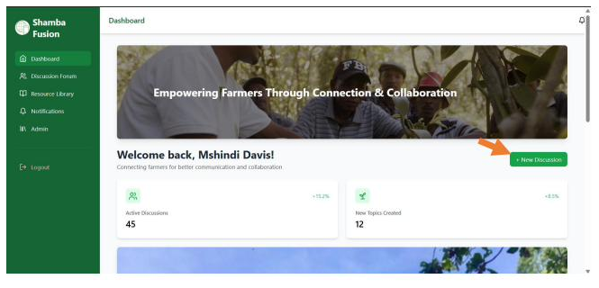
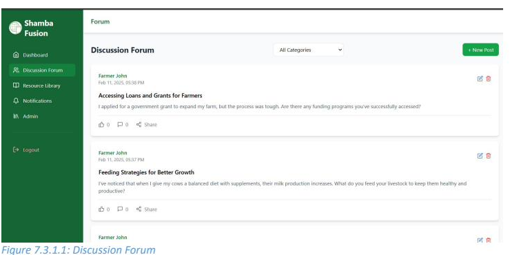
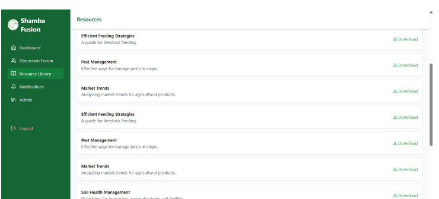

# Shamba Fusion

**An Online Community of Practice for Farmers in Smart Agriculture**

A full-stack web platform that connects smallholder farmers, agricultural experts, researchers, and NGOs in a shared digital space for knowledge sharing, expert consultation, and access to curated agricultural resources. Built as the final-year project for a BSc in Information Systems & Technology at United States International University–Africa.

> 🇰🇪 Designed for the Kenyan smallholder farming context, with Molo, Nakuru County as the pilot site. Aligned with UN Sustainable Development Goal 2 (Zero Hunger).

---

## Table of Contents

- [Overview](#overview)
- [Tech Stack](#tech-stack)
- [System Architecture](#system-architecture)
- [Features](#features)
- [Screenshots](#screenshots)
- [Project Structure](#project-structure)
- [Getting Started](#getting-started)
- [Academic Context](#academic-context)
- [Author](#author)

---

## Overview

Smallholder farmers in rural Kenya face persistent barriers in accessing timely agricultural information: fragmented communication channels, delayed expert advice, limited peer-to-peer knowledge exchange, and unreliable sources. Shamba Fusion addresses these gaps by providing a single, structured digital hub where farmers can post questions, browse a curated resource library, exchange best practices with peers, and receive guidance from agricultural experts and researchers.

The platform was developed end-to-end as part of an undergraduate research project that included a 100-respondent field survey (87% response rate), system requirements analysis, full-stack development, and prototype deployment.

## Tech Stack

**Frontend**
- React 18 (Vite)
- Tailwind CSS
- Axios

**Backend**
- Node.js
- Express
- JSON Web Tokens (JWT) for authentication
- bcrypt for password hashing
- Multer for file uploads

**Database**
- MySQL (managed via phpMyAdmin during development)

**Tooling**
- WebStorm (IDE)
- Git & GitHub (version control)
- Postman (API testing)
- draw.io (system modeling)

## System Architecture

A three-tier architecture: a React single-page frontend communicates with a Node.js/Express REST API, which persists data to a MySQL relational database. Five user roles (farmers, agricultural experts, researchers, NGOs, administrators) interact with the platform through role-based access control.


## Features

- **🔐 Authentication & role-based access** — Secure registration and login with JWT-based sessions; five distinct user roles with permission scoping for moderation, content upload, and administration.
- **💬 Discussion forum** — Categorised threads (Crop Cultivation, Livestock Management, Market & Pricing, etc.) where farmers post questions, comment, like, and share.
- **📚 Resource library** — Centralised repository of agricultural guides, research papers, and best practices, uploadable by experts and researchers, downloadable by all users.
- **🔔 Notifications system** — Real-time alerts for new replies, new resources, and platform updates.
- **🔍 Search & filtering** — Filter discussions by category and search across the resource library.
- **🛡️ Admin dashboard** — User management, discussion moderation, and system reports for administrators.
- **📱 Responsive UI** — Built with Tailwind to work on desktop, tablet, and mobile.

## Screenshots

### Dashboard


### Discussion Forum


### Resource Library


## Project Structure
FinalProject/
├── backend/
│   ├── config/          # Database configuration
│   ├── controllers/     # Request handlers (auth, posts, resources, etc.)
│   ├── middleware/      # Auth middleware, file upload middleware
│   ├── routes/          # API route definitions
│   ├── utils/           # Helper utilities
│   ├── server.js        # Express entry point
│   └── package.json
├── frontend/
│   ├── src/
│   │   ├── components/  # React components (auth, dashboard, posts, resources, ui)
│   │   ├── hooks/       # Custom React hooks
│   │   ├── pages/       # Page-level components
│   │   ├── services/    # API service layer
│   │   ├── utils/       # Frontend utilities
│   │   └── App.jsx
│   ├── index.html
│   └── package.json
└── docs/
└── images/          # Architecture diagrams and screenshots

## Getting Started

### Prerequisites

- Node.js 18+ and npm
- MySQL 8+ (or MariaDB equivalent)
- Git

### Setup

1. **Clone the repository**
```bash
   git clone https://github.com/IvynTonui/ShambaFusion.git
   cd ShambaFusion
```

2. **Set up the database**
    - Create a MySQL database (e.g., `shamba_fusion`)
    - Import the schema (a SQL dump can be provided on request)

3. **Configure backend environment**
    - In `backend/`, create a `.env` file with the following variables:
      DB_HOST=localhost
      DB_USER=your_db_user
      DB_PASSWORD=your_db_password
      DB_NAME=shamba_fusion
      JWT_SECRET=your_jwt_secret
      PORT=3001
      UPLOAD_DIR=uploads

4. **Install backend dependencies and run**
```bash
   cd backend
   npm install
   node server.js
```
The API will be available at `http://localhost:3001`.

5. **Install frontend dependencies and run**
```bash
   cd frontend
   npm install
   npm run dev
```
The frontend will be available at `http://localhost:5173`.

## Academic Context

This project was submitted as the final-year capstone (APT/IST 4900A) for the BSc in Information Systems & Technology at United States International University–Africa, Spring 2025, under the supervision of Dr. Collins Oduor (Assistant Professor, School of Science and Technology).

The research component followed a descriptive design combining qualitative and quantitative methods. A structured questionnaire was distributed to 100 stakeholders (smallholder farmers, agricultural experts, and researchers), with 87 valid responses (87% response rate). Findings confirmed strong demand for a centralised digital community: 100% of respondents recommended adoption, with discussion forums (100%), expert consultations (96.6%), and access to a structured research library (96.6%) ranked as the most-wanted features.

## Author

**Ivyn Chepchumba Tonui**
BSc Information Systems & Technology, USIU–Africa (2025)
📧 tonuiivyn2@gmail.com
🔗 [GitHub](https://github.com/IvynTonui)

---

*Built with the belief that better tools for farmers means better food security for everyone.*
