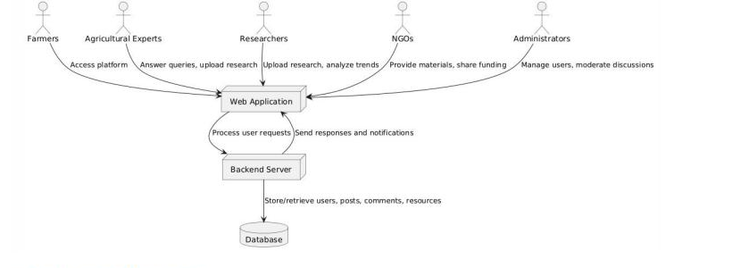
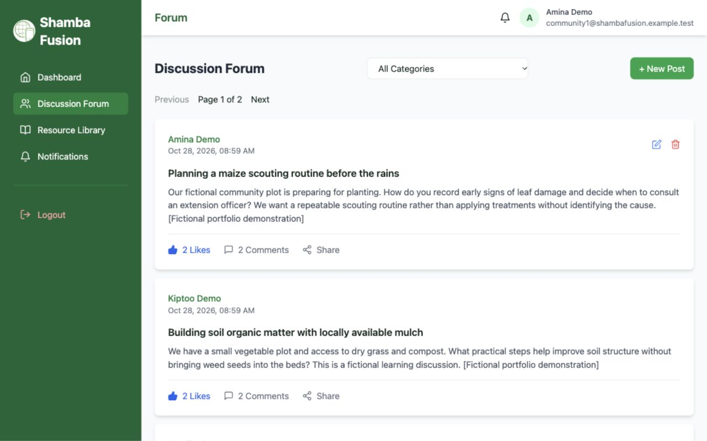
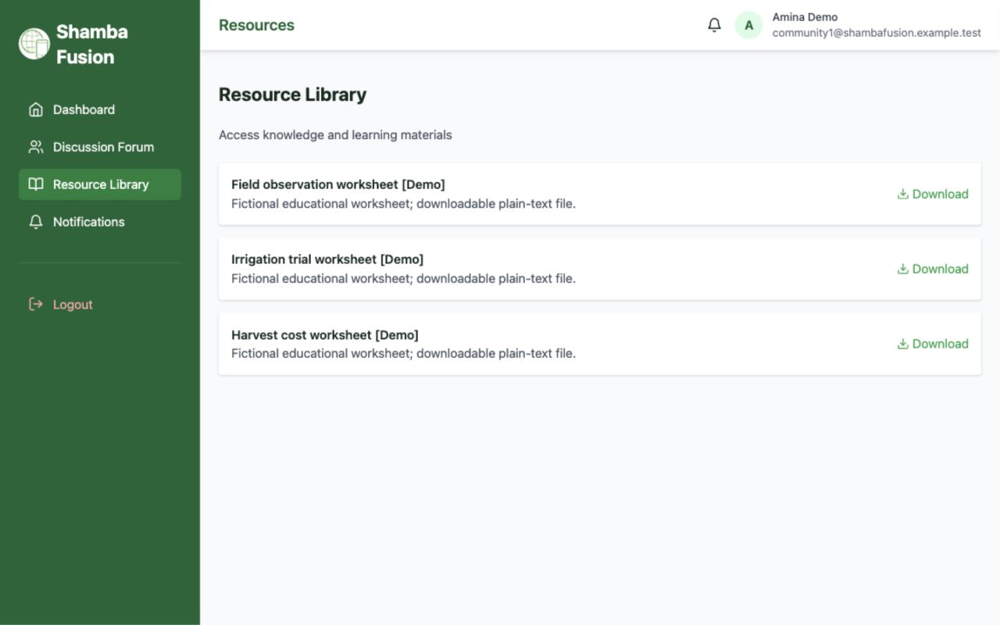

# Shamba Fusion

A full-stack community application for sharing practical agricultural knowledge. Participants ask questions, discuss farming practices and access a curated resource library; administrators manage users, discussions and resources.

Built as an undergraduate BSc Information Systems & Technology project at **United States International University–Africa (2025)**, with Kenyan smallholder farmers and Molo, Nakuru County as the original context. Portfolio maintenance in October 2026 focuses on authorization, reliable discussion workflows, safer uploads, responsive navigation and reproducible setup.

## Architecture and technology

React 18 + Vite + Tailwind CSS → Axios REST requests → Node.js + Express → MySQL (`mysql2`). Authentication uses bcrypt password hashes and signed JWTs. The server checks the current database role on authenticated requests. Multer handles bounded, signature-checked uploads. Recharts supports the administration reports.



The architecture image is from the academic prototype; the implemented permission model is **participant / administrator**. Farmer, researcher and NGO are domain audiences, not separately enforced roles.

## Implemented scope

- Registration, login, logout and authenticated navigation.
- Discussion creation, editing by owners, deletion by owners/admins, detail/share links, category filters and paginated feed.
- Comments and likes; persisted notifications fetched when opening the notifications page.
- Public resource browsing; authenticated downloads; administrator uploads of PDF, PNG and JPEG (5 MB maximum).
- Administrator user management, discussion moderation, resources and reports.
- Responsive navigation and explicit loading/error/empty states.

Notifications are **not real-time**. Resource search, expert consultation scheduling and five distinct permission roles are not implemented.

## Screenshots

Current interface (October 28, 2026):

[Current populated mobile preview](docs/images/09-populated-mobile.png). The populated forum and resource library below were captured from the current application. All displayed community activity is fictional demo data.




## Local setup

Prerequisites: Node.js 22 LTS or newer supported LTS, npm, MySQL 8 and a MySQL user permitted to access your chosen database. Use separate terminals for frontend/backend.

```sh
git clone https://github.com/IvynTonui/ShambaFusion.git
cd ShambaFusion
cd backend
npm ci
cp .env.example .env
```

Edit the new private `backend/.env` with `DB_HOST`, `DB_USER`, `DB_PASSWORD`, `DB_NAME`, `JWT_SECRET` (generate with `openssl rand -hex 32`) and `PORT=3001`. Never overwrite an existing `.env`. Optional `FRONTEND_ORIGIN` defaults to `http://localhost:5173`.

### Existing database

Keep your current database and configuration. **Do not import the reconstructed schema into it.** Existing foreign keys and schema compatibility must be checked independently; the schema below is a reconstruction, not a migration.

### Fictional demo data in the verified local database

The local `shamba_fusion` database is populated with fictional agricultural discussions,
comments, likes and three real downloadable worksheets. Existing accounts were preserved.
From `backend/`, rerun the guarded additive seed with:

```sh
npm run demo:seed -- --confirm-local
```

Demo participant logins use `community1@shambafusion.example.test` through
`community4@shambafusion.example.test`. Generated passwords are stored only in the
ignored local `backend/.demo-credentials.json`; inspect it privately. No demo
administrator is created. See [demo data and safety notes](docs/DEMO_DATA.md).

### Fresh database setup — not yet verified

`backend/database/schema.sql` is a reconstruction for a new empty database only.
Create a separate empty database with your MySQL client, then import it explicitly:

```sh
mysql -u YOUR_DB_USER -p YOUR_NEW_EMPTY_DATABASE < database/schema.sql
```

Do not import it into an existing database. Its types and deletion constraints
differ from the verified live schema, as documented in `docs/DEMO_DATA.md`.
The current seed intentionally supports only the verified local `shamba_fusion`
database; it refuses other names. Fresh installation and fresh-data seeding remain
unverified and are not represented as a tested one-command setup.

### Run

From `backend/`:

```sh
npm start
```

In another terminal, from `frontend/`:

```sh
npm ci
npm run dev
```

Open **http://localhost:5173**. API: **http://localhost:3001**. The frontend defaults to `http://localhost:3001/api`; optional `frontend/.env` can set `VITE_API_URL` using `.env.example`. Restart servers after changing environment variables. Use `localhost` consistently with the default CORS configuration.

## Checks

```sh
cd backend
npm test
cd ../frontend
npm run build
```

Backend tests use mocked database boundaries and do not connect to your database. They verify authorization, stale-role handling and selected controller contracts. They do not replace full MySQL/browser integration testing. Live demo verification additionally covers 30 authenticated API checks; see [verification notes](docs/VERIFICATION.md) for actual results and limits. Existing lint debt is not a release claim; `npm run lint` still reports legacy issues.

## Project structure

```text
backend/   Express routes, controllers, middleware, database/schema.sql,
           scripts/seed-demo.js and tests/
frontend/  React pages, components, services and styles
 docs/     Prototype images, demo checklist and verification notes
```

## Known limitations and deployment

JWTs are stored in localStorage; an XSS issue could expose a session. This is a portfolio demonstration, without email verification, password recovery, malware scanning or real-time infrastructure. Signature checks do not guarantee an uploaded document is harmless. Uploaded files are publicly addressable under `/uploads`; do not upload private material. Only use synthetic data in a public demo.

Likes use multiple queries and are not transactionally consistent under concurrent requests. Resource file cleanup and database deletion are not a single atomic operation. Existing database cascade behavior may differ from the reconstructed schema. Account deletion is permanent and removes related data in the demo schema.

For future hosting, configure HTTPS, API/CORS origins, SPA fallback for detail routes, persistent upload storage, database backups and a least-privilege database account. Do not publish a demo administrator password in a public README. Deployment and GitHub publishing are separate manual steps.

## Author

**Ivyn Chepchumba Tonui** — BSc Information Systems & Technology, USIU–Africa (2025). [GitHub](https://github.com/IvynTonui).
